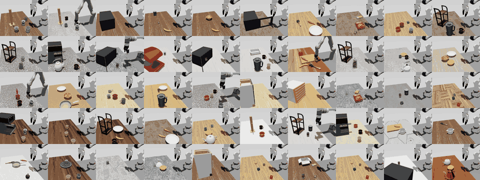
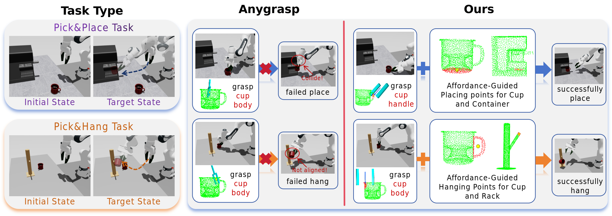
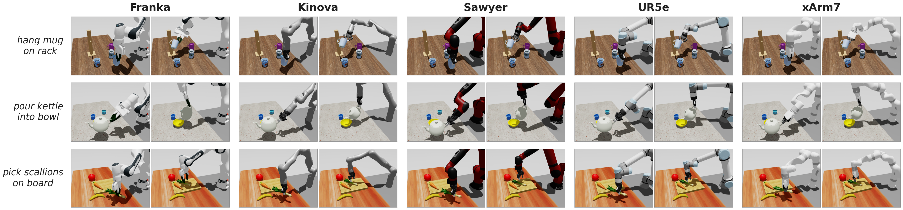
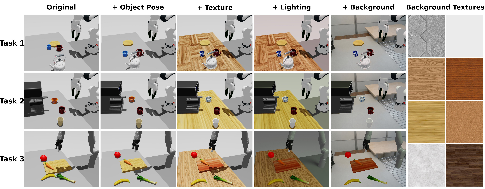

# AffordSim: A Scalable Data Generator and Benchmark for Affordance-Aware Robotic Manipulation

<p align="center">
  <a href="#license"></a>
  
  
  
</p>

<p align="center">
  
</p>

## Introduction

**AffordSim** is the first simulation framework that integrates open-vocabulary 3D affordance prediction into the robotic manipulation data generation pipeline. Existing simulation platforms do not incorporate object affordance information into trajectory generation, making it impossible to automatically generate semantically correct trajectories for tasks that require precise interaction with specific functional regions - such as grasping a mug by its handle, pouring from a cup's rim, or hanging a mug on a hook.

AffordSim addresses this by using **VoxAfford**, an open-vocabulary 3D affordance detector that enhances MLLM output tokens with multi-scale geometric features, to predict affordance maps on object point clouds and guide grasp pose estimation toward task-relevant functional regions. Built on NVIDIA Isaac Sim, AffordSim features:

- **Affordance-aware trajectory generation.** VoxAfford predicts 3D affordance heatmaps on object point clouds, guiding grasp pose selection toward task-relevant functional regions.
- **Automated task-scene generation.** A VLM-powered pipeline converts natural language task descriptions into simulation scenes, supporting 4 robot embodiments (Franka FR3, Panda, UR5e, Kinova) without task-specific engineering.
- **Photorealistic domain randomization.** Five randomization axes - including DA3-based 3D Gaussian reconstruction from real photographs - reduce the visual domain gap for sim-to-real transfer.
- **A 50-task benchmark** across 7 manipulation categories (grasping, placing, stacking, pushing/pulling, pouring, mug hanging, long-horizon composite) with evaluations of 5 imitation learning baselines (BC, Diffusion Policy, ACT, VLA-Adapter, Pi 0.5).

<p align="center">
  
  <br>
  <em>Affordance-guided grasp planning vs. generic grasp estimation.</em>
</p>


## Installation

### Prerequisites

- **OS**: Linux (Ubuntu 22.04 recommended)
- **Python**: 3.11
- **GPU**: NVIDIA GPU with CUDA >=12.7 support
- **NVIDIA Isaac Sim**:  5.1

### Step 1: Clone the Repository

```bash
git clone <repo_url> AffordSim
cd AffordSim
```

### Step 2: Create Conda Environment

```bash
conda create -n env_affordsim python=3.11
conda activate env_affordsim
```

### Step 3: Install IsaacSim 5.1 and IsaacLab 2.3.1

```bash
pip install "isaaclab[isaacsim,all]==2.3.1" --extra-index-url https://pypi.nvidia.com
```

### Step 4: Install PyTorch

```bash
pip install -U torch==2.7.0 torchvision==0.22.0 --index-url https://download.pytorch.org/whl/cu128
```

### Step 5: Install cuRobo

```bash
unzip curobo.zip
cd curobo
python -m pip install -e .[isaacsim] --no-build-isolation
```

> **Note:** Warnings about `packaging` / `wheel` version conflicts during cuRobo installation can usually be ignored if the install finishes successfully.

### Step 6: Install AnyGrasp SDK

It is recommended to install AnyGrasp in a separate Conda environment to avoid version conflicts with the main `affordsim` environment.

Follow the [AnyGrasp SDK](https://github.com/graspnet/anygrasp_sdk) installation guide:

```bash
# Install MinkowskiEngine (modified version)
mkdir dependencies && cd dependencies
conda install openblas-devel -c anaconda
export CUDA_HOME=/usr/local/cuda
git clone git@github.com:chenxi-wang/MinkowskiEngine.git
cd MinkowskiEngine
# For CUDA 12.x, uncomment the following line:
# git checkout cuda-12-1
python setup.py install --blas_include_dirs=${CONDA_PREFIX}/include \
    --blas_library_dirs=${CONDA_PREFIX}/lib --blas=openblas
cd ../..

# Install AnyGrasp dependencies
pip install -r requirements.txt

# Build PointNet2
cd pointnet2
python setup.py install
cd ..
```

> **Note:** AnyGrasp SDK requires a license. Please refer to the [license registration](https://github.com/graspnet/anygrasp_sdk#license-registration) section to obtain your license file.

After the AnyGrasp environment is ready, set:

```bash
export ANYGRASP_HOME=/path/to/anygrasp
export ANYGRASP_CONDA_ENV=<your_anygrasp_conda_env>
cp tools/anygrasp/grasp_detection/demo_pick.py "$ANYGRASP_HOME/grasp_detection/demo_pick.py"
```

### Step 7: Install Project Runtime Dependencies

```bash
python -m pip install ruamel.yaml
python -m pip install openai
python -m pip install diffusers einops
```

### Step 8: Configure Runtime Environment

```bash
ln -s $CONDA_PREFIX/lib/python3.11/site-packages/isaaclab/apps ./apps
export PYTHONPATH=$PWD/source/isaaclab:$PWD/source/isaaclab_tasks:$PWD/source/isaaclab_assets:$PYTHONPATH
```

### First Launch

On the first launch, Omniverse Kit will ask you to accept the NVIDIA Omniverse EULA:

```text
Do you accept the EULA? (Yes/No):
```

Type `Yes`. The first startup may take a while.


## Usage

### Scene Editor

The scene editor is optional. This repository already includes 50 task YAML files under `source/isaaclab_tasks/isaaclab_tasks/real2sim/tasks/config/task/`, so you do not need the editor to run the provided benchmark tasks.

Use the scene editor only if you want to create or modify your own tabletop scene and task configuration.

If you want to generate a scene from natural language, the editor requires your own OpenAI-compatible LLM API configuration:

```bash
export DASHSCOPE_API_KEY=<your_api_key>
export DASHSCOPE_BASE_URL=<your_openai_compatible_base_url>
export DASHSCOPE_MODEL=<your_model_name>
```

For example, with DashScope:

```bash
export DASHSCOPE_API_KEY=<your_dashscope_api_key>
export DASHSCOPE_BASE_URL=https://dashscope.aliyuncs.com/compatible-mode/v1
export DASHSCOPE_MODEL=qwen-vl-plus
```

If these variables are not set correctly, scene creation from text will fail when the editor tries to call the LLM.

Launch it with:

```bash
python scripts/run_data_collect_improve.py
```

This starts the interactive editor and does not collect data. A typical workflow is:

1. At the `SCENE GENERATION` prompt, choose how to initialize the scene:
   - `1: Generate from text` lets the LLM create a tabletop scene from a natural-language description.
   - `2: Load from YAML` loads an existing task YAML and continues editing from it.
2. If you choose `1`, enter a scene description at `Scene description:`. Example:

   ```text
   a banana, a carrot, a plate, a cuttingboard and one random object. The carrot is on the cuttingboard, and the banana is beside the plate.
   ```

   The editor will generate the initial object layout and restart into edit mode.

   If a name in the scene description matches multiple object labels, the editor will show the candidate labels and ask you to choose the intended one manually.
3. In `EDIT MODE`, use the menu to refine the scene:
   - `2: Add object`
   - `3: Remove object`
   - `5: Modify object position`
   - `6: Modify object rotation`
   - `4: Regenerate scene` if you want to start over
4. When the scene is ready, choose `1: Save & Exit`.
5. Enter a task description at `Task description:`. Example:

   ```text
   pick the banana and place it in the plate
   ```

   The editor will parse the task into primitives and then ask whether to enable:
   - random lights,
   - texture randomization,
   - object pose randomization,
   - image noise and speckle noise.

   If a target name in the task description is ambiguous and matches multiple labels in the current scene, the editor will also ask you to select the correct object before export.
6. After export, the editor prints `Complete shutdown finished` and exits.

By default, the exported YAML is written to:

```text
source/isaaclab_tasks/isaaclab_tasks/real2sim/tasks/config/task/pick/scene_editor_output.yaml
```

You should then rename or move this file to a proper task name, for example:

```text
source/isaaclab_tasks/isaaclab_tasks/real2sim/tasks/config/task/pick/pick_banana_place_plate.yaml
```

After that, proceed to data collection using the new task name.

### Data Collection

To collect trajectories for an existing task YAML, run:

```bash
python scripts/run_data_collect_improve.py \
    --enable_cameras \
    --skip_editor \
    --num_envs 2 \
    --robot franka_fr3 \
    --task_name pick_banana_place_bowl \
    --headless
```

Key arguments:
| Argument | Description |
|---|---|
| `--task_name` | Task name. The script resolves the YAML automatically from `source/isaaclab_tasks/isaaclab_tasks/real2sim/tasks/config/task/<category>/<task_name>.yaml`. |
| `--robot` | Robot embodiment override. Supported values include `franka_fr3`, `ur5e`, `kinova_robotiq85`, `xarm7_ufactory`, and `sawyer_robotiq85`. |
| `--num_envs` | Number of parallel environments |
| `--episodes` | Override the number of collection episodes in the YAML |
| `--headless` | Run without GUI (for large-scale collection) |

Typical workflow:

1. Run `python scripts/run_data_collect_improve.py` to create and export a task YAML.
2. Run `python scripts/run_data_collect_improve.py --skip_editor ...` to collect trajectories for that task.

### Training Imitation Learning Policies

AffordSim supports multiple imitation learning backends.

#### Data Preprocessing

Before training, convert collected raw data into the HDF5 format required by the IL backends.

1. Convert `episode_*.npy` files to per-episode HDF5 files:

```bash
python tools/np2hdf5.py \
    --npy_folder <path_to_npy_episode_dir> \
    --ref data/reference.hdf5 \
    --out <path_to_hdf5_episode_dir>
```

2. Merge the per-episode HDF5 files into a single raw trajectory file:

```bash
COMBINE_DATA_DIR=<path_to_hdf5_episode_dir> \
COMBINE_OUTPUT_FILE=<merged_trajectories.hdf5> \
COMBINE_EPISODES=<num_episodes> \
python tools/combine_hdf5.py
```

3. Convert the merged file into robomimic format and generate `dataset_stat.json`:

```bash
python tools/convert_hdf5_for_robomimic.py \
    --src <merged_trajectories.hdf5> \
    --dst <target_hdf5_path> \
    --stat <dataset_stat.json>
```

The resulting `<target_hdf5_path>` and `<dataset_stat.json>` can be used by BC, ACT, and DP.

#### Training

**Behavioral Cloning (BC):**
```bash
python scripts/imitation_learning/BC/train_bc.py \
    --dataset <target_hdf5_path> \
    --stat <dataset_stat.json> \
    --exp_name <experiment_name> \
    --total_iters 1000 \
    --batch_size 8 \
    --save_freq 50 \
    --log_freq 10 \
    --action_chunk_size 8 \
    --action_horizon 4 \
    --no_remove_idle \
    --eval_task_config <path_to_task_yaml> \
    --eval_task <name_to_eval_task> \
    --eval_num_rollouts 5 \
    --eval_horizon 300
```

**Diffusion Policy:**
```bash
python scripts/imitation_learning/dp/train.py \
    --dataset <target_hdf5_path> \
    --stat <dataset_stat.json> \
    --output_dir logs/dp_run \
    --epochs 1000 \
    --save_every 50 \
    --batch_size 8 \
    --pred_horizon 16 \
    --obs_horizon 2 \
    --action_horizon 8 \
    --action_type ee_delta \
    --eval_task_config <path_to_task_yaml> \
    --eval_task <name_to_eval_task> \
    --eval_num_rollouts 5 \
    --eval_horizon 300
```

**ACT (Action Chunking Transformers):**
```bash
python scripts/imitation_learning/ACT/train_act.py \
    --dataset <target_hdf5_path> \
    --stat <dataset_stat.json> \
    --exp_name <experiment_name> \
    --total_iters 1000 \
    --batch_size 8 \
    --save_freq 50 \
    --log_freq 10 \
    --action_chunk_size 16 \
    --action_horizon 8 \
    --kl_weight 10.0 \
    --eval_task_config <path_to_task_yaml> \
    --eval_task <name_to_eval_task> \
    --eval_num_rollouts 5 \
    --eval_horizon 300
```

To run pure training without rollout evaluation, remove:

```bash
--eval_task_config <path_to_task_yaml> \
--eval_task <name_to_eval_task> \
--eval_num_rollouts 5 \
--eval_horizon 300
```

> **Note:**
> - `<path_to_task_yaml>`: Task config files are located in `source/isaaclab_tasks/isaaclab_tasks/real2sim/tasks/config/task/` (subdirectories: `pick`, `pour`, `hang`, `stack`, `pull_push`, `open_close`, `composite`).
> - `<name_to_eval_task>`: Registered task IDs can be found in [source/isaaclab_tasks/isaaclab_tasks/real2sim/tasks/\_\_init\_\_.py](source/isaaclab_tasks/isaaclab_tasks/real2sim/tasks/__init__.py) (e.g., `Pick_Place_banana-v0`, `Pick_cupwithhandle_Pour-v0`). To add a custom task, register it following the same pattern in this file.

### Evaluation

Evaluate trained policies:

**BC:**
```bash
python scripts/imitation_learning/BC/play_bc.py \
    --checkpoint <checkpoint_path> \
    --dataset_stat <dataset_stat.json> \
    --task <name_to_eval_task> \
    --task_config <path_to_task_yaml> \
    --horizon 250 \
    --enable_cameras \
    --save_img_interval 0 \
    --num_rollouts 1 \
    --headless
```

**Diffusion Policy:**
```bash
python scripts/imitation_learning/dp/play.py \
    --checkpoint <checkpoint_path> \
    --stat <dataset_stat.json> \
    --task <name_to_eval_task> \
    --task_config <path_to_task_yaml> \
    --horizon 250 \
    --enable_cameras \
    --num_rollouts 1 \
    --headless
```

**ACT:**
```bash
python scripts/imitation_learning/ACT/play_act.py \
    --checkpoint <checkpoint_path> \
    --stat <dataset_stat.json> \
    --task <name_to_eval_task> \
    --task_config <path_to_task_yaml> \
    --horizon 250 \
    --enable_cameras \
    --save_img_interval 0 \
    --num_rollouts 1 \
    --headless
```

## Cross-Embodiment Support

AffordSim supports 4 robot embodiments with automatic kinematic adaptation - no task-specific tuning required:

<p align="center">
  
</p>

| Robot | Trajectory Generation Success Rate |
|---|---|
| Franka FR3 | 94% |
| Franka Panda | 92% |
| UR5e | 83% |
| Kinova | 95% |

## Domain Randomization

AffordSim applies domain randomization along five axes to enable zero-shot sim-to-real transfer:

<p align="center">
  
</p>

1. **Background texture** - random textures on workspace and surrounding surfaces
2. **Lighting** - randomized number, position, intensity, and color of light sources
3. **Object texture** - PBR material property perturbation
4. **Object pose** - small random perturbations to initial positions and orientations
5. **DA3 Gaussian background** - photorealistic backgrounds from 3D Gaussian Splatting reconstruction of real scenes

## Benchmark Evaluation

Each task is trained on 300 demonstrations with object pose randomization applied during data collection; all evaluation rollouts also include object pose randomization to test generalization.

<table>
<thead>
<tr><th>Category</th><th>Task</th><th align="center">BC</th><th align="center">DP</th><th align="center">ACT</th><th align="center">VLA-Adapter</th><th align="center">Pi 0.5</th></tr>
</thead>
<tbody>
<tr><td rowspan="4">Pick &amp; Place</td><td>pick_banana_place_plate</td><td align="center">40</td><td align="center">87</td><td align="center">47</td><td align="center">87</td><td align="center"><b>93</b></td></tr>
<tr><td>pick_cup_place_shelf</td><td align="center">7</td><td align="center">28</td><td align="center">26</td><td align="center">55</td><td align="center"><b>61</b></td></tr>
<tr><td>pick_mug_place_coffee_machine</td><td align="center">10</td><td align="center">33</td><td align="center">27</td><td align="center">51</td><td align="center"><b>53</b></td></tr>
<tr><td>pick_lid_place_pot</td><td align="center">13</td><td align="center">37</td><td align="center">17</td><td align="center"><b>53</b></td><td align="center">50</td></tr>
<tr><td rowspan="5">Pour</td><td>pour_scoop_into_bowl</td><td align="center">13</td><td align="center">35</td><td align="center">31</td><td align="center">62</td><td align="center"><b>67</b></td></tr>
<tr><td>pour_pan_into_bowl</td><td align="center">10</td><td align="center">46</td><td align="center">33</td><td align="center"><b>75</b></td><td align="center">74</td></tr>
<tr><td>pour_red_mug_into_bowl</td><td align="center">3</td><td align="center">24</td><td align="center">13</td><td align="center">62</td><td align="center"><b>68</b></td></tr>
<tr><td>pour_cup_without_handle_into_cup</td><td align="center">0</td><td align="center">12</td><td align="center">8</td><td align="center">31</td><td align="center"><b>36</b></td></tr>
<tr><td>pick_kettle_pour_place</td><td align="center">3</td><td align="center">33</td><td align="center">26</td><td align="center"><b>56</b></td><td align="center">53</td></tr>
<tr><td rowspan="2">Hang</td><td>hang_white_cup_on_rack</td><td align="center">4</td><td align="center">23</td><td align="center">10</td><td align="center"><b>47</b></td><td align="center">42</td></tr>
<tr><td>hang_red_mug_on_rack</td><td align="center">3</td><td align="center">23</td><td align="center">21</td><td align="center"><b>46</b></td><td align="center">44</td></tr>
<tr><td rowspan="2">Pull/Push</td><td>push_can_to_target</td><td align="center">27</td><td align="center">57</td><td align="center">53</td><td align="center">70</td><td align="center"><b>73</b></td></tr>
<tr><td>pull_cabinet_open</td><td align="center">24</td><td align="center">60</td><td align="center">57</td><td align="center"><b>74</b></td><td align="center">71</td></tr>
<tr><td rowspan="2">Open/Close</td><td>open_microwave</td><td align="center">20</td><td align="center">38</td><td align="center">40</td><td align="center"><b>60</b></td><td align="center">57</td></tr>
<tr><td>close_microwave</td><td align="center">22</td><td align="center">46</td><td align="center">42</td><td align="center"><b>76</b></td><td align="center">71</td></tr>
<tr><td rowspan="5">Long-Horizon</td><td>pour_kettle_and_teapot</td><td align="center">0</td><td align="center">4</td><td align="center">2</td><td align="center">18</td><td align="center"><b>21</b></td></tr>
<tr><td>open_microwave_and_pick_can</td><td align="center">0</td><td align="center">4</td><td align="center">0</td><td align="center"><b>15</b></td><td align="center">13</td></tr>
<tr><td>store_cups_on_plates</td><td align="center">0</td><td align="center">4</td><td align="center">0</td><td align="center">10</td><td align="center"><b>12</b></td></tr>
<tr><td>pour_sugar_pick_mug_into_coffeemachine</td><td align="center">0</td><td align="center">4</td><td align="center">4</td><td align="center">18</td><td align="center"><b>20</b></td></tr>
<tr><td>organize_the_clutter_into_baskets</td><td align="center">0</td><td align="center">15</td><td align="center">9</td><td align="center">32</td><td align="center"><b>35</b></td></tr>
<tr><td colspan="2"><b>Average (20 tasks)</b></td><td align="center"><b>10</b></td><td align="center"><b>31</b></td><td align="center"><b>23</b></td><td align="center"><b>50</b></td><td align="center"><b>51</b></td></tr>
</tbody>
</table>

**Key findings:**
- **Pi 0.5** achieves the highest average success rate (51%), with **VLA-Adapter** close behind (50%). Both substantially outperform DP (31%), ACT (23%), and BC (10%), indicating that VLM-conditioned policies are markedly more effective on affordance-aware manipulation than purely visuomotor baselines.
- **Placing** tasks span a wide range (7-93%): simple placements like banana-on-plate are largely solved, while precision-constrained placements like cup-on-shelf remain hard for non-VLM baselines.
- **Affordance-demanding** tasks expose a clear capability gap: pouring with a wide receptacle (pan-into-bowl, scoop-into-bowl) reaches 67-75%, but pouring a handle-less cup into another cup drops to 0-36%. Mug hanging caps at ~47% even for the best baseline - fine-grained functional-region interaction remains the main bottleneck.
- **Long-horizon composite** tasks are the hardest: BC fails entirely (0% on all 5), DP/ACT collapse to <=15%, and even the best baselines top out at 12-35%, highlighting the difficulty of multi-stage task chaining under affordance constraints.

## Project Structure

```
AffordSim/
├── source/
│   ├── isaaclab/                 # Core framework (simulation, assets, sensors, controllers)
│   │   └── isaaclab/motion_collect/  # Affordance-aware motion collection module
│   ├── isaaclab_tasks/           # 30+ task environment implementations
│   ├── isaaclab_assets/          # Robot and sensor asset definitions
│   └── isaaclab_mimic/           # Imitation learning (cuRobo integration)
├── scripts/
│   ├── run_data_collect_improve.py   # Main data collection entry point
│   ├── run_eval.py               # Evaluation script
│   └── imitation_learning/       # IL training and rollout scripts (BC, ACT, DP, robomimic, Pi 0.5)
├── curobo/                       # GPU-accelerated motion planning library
├── backgrounds/                  # DA3 Gaussian background assets
├── isaaclab.sh                   # Build and execution interface
```

## License

The AffordSim framework is released under [BSD-3 License](LICENSE). The `isaaclab_mimic` extension is released under [Apache 2.0](LICENSE-mimic). See [`docs/licenses`](docs/licenses) for dependency licenses.

## Citation

If you find AffordSim useful in your research, please cite:

```bibtex
@article{anonymous2026affordsim,
  title={AffordSim: A Scalable Data Generator and Benchmark for Affordance-Aware Robotic Manipulation},
  author={Anonymous},
  journal={Under review},
  year={2026}
}
```

## Acknowledgement

AffordSim is built on top of Isaac Lab.
